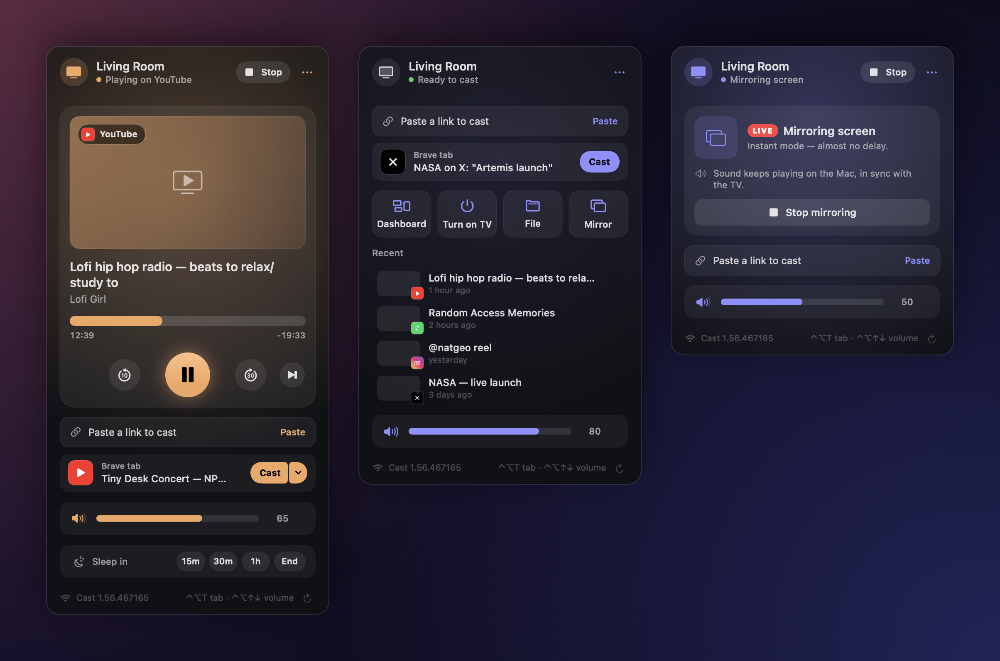
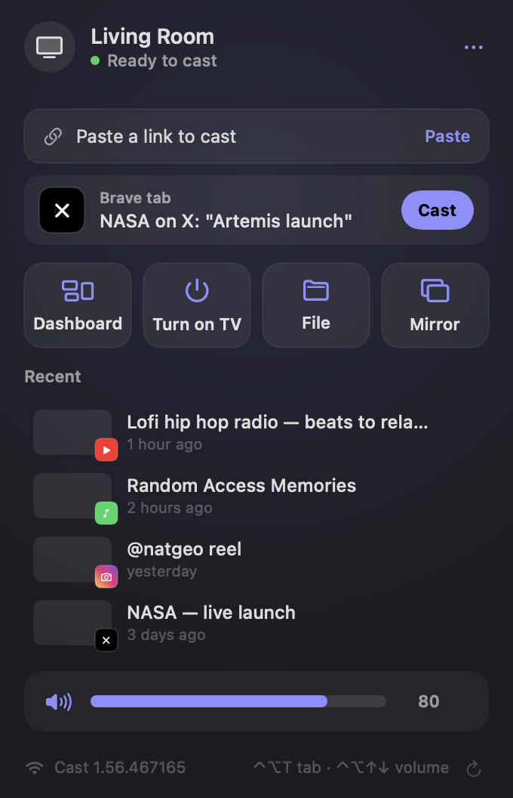
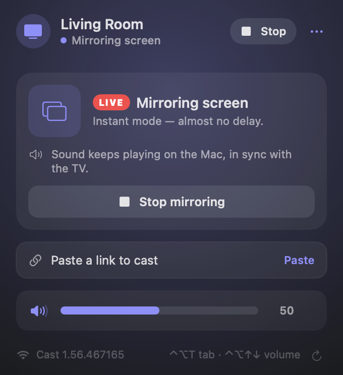

<div align="center">

# Chromecast Menubar

**English** · [Português](README.pt-BR.md)

**Control your Chromecast from the Mac menu bar and send YouTube, Spotify, Instagram and X to the TV straight from your browser.**

Built for (and tested on) the **1st-generation Chromecast**, which still works fine and still speaks the protocol.




</div>

## Features

- **Cast the browser tab:** shows the active tab of Brave, Chrome, Safari, Arc or Edge with a **Cast** button, or press **⌃⌥T** from anywhere. You don't need the browser's cast icon.
- **YouTube:** plays in the YouTube app on the TV, with **play next**, **add to queue** and **skip**. Supports `watch`, `youtu.be`, `shorts`, `live`, playlists and `t=`.
- **Spotify:** links play through the Spotify app on your Mac, which sends them to the TV via Spotify Connect.
- **Instagram and X:** videos are resolved with [yt-dlp](https://github.com/yt-dlp/yt-dlp). X works without signing in; Instagram can use your browser session (opt-in).
- **Files and links:** drop a video, song, photo or link on the panel, or use *Open With → Chromecast* in Finder. HEVC and 4K are converted to 1080p H.264 for the 1st-gen device.
- **Mirror your Mac, instantly:** uses Cast Streaming (the same protocol Chrome uses for tab casting) with H.264 encrypted RTP. About 0.2–0.3 s behind; Mac audio stays in sync on the Mac. Falls back to live HLS (~4 s) if a receiver refuses the offer.
- **Now Playing and media keys:** ⏯ ⏮ ⏭ control the TV, and the macOS Now Playing widget shows artwork and progress. **⌃⌥↑ / ⌃⌥↓** change the TV volume with an on-screen HUD.
- **Sleep timer:** 15m / 30m / 1h or *end of episode*. In the last minute the volume fades out, then casting stops and the volume goes back to where it was.
- **TV dashboard:** a full-screen clock, date and weather when nothing is playing.
- **Turn on TV:** wakes the TV and switches input over HDMI-CEC.
- **Device menu:** rename or restart the Chromecast; firmware and Wi-Fi signal in the footer.
- **Stays connected:** heartbeat watchdog, exponential backoff, reconnect on wake and network changes, and a fallback to the last known IP when Bonjour misses the device.
- **English and Portuguese**, following your system language.

| Home | Mirroring |
|:---:|:---:|
|  |  |

## Install

You need macOS 14 or later and the Xcode Command Line Tools (`xcode-select --install`). The full Xcode isn't required.

```bash
git clone https://github.com/LuisMFG/chromecast-menubar.git
cd chromecast-menubar
./build-app.sh
cp -R build/Chromecast.app /Applications/
open /Applications/Chromecast.app
```

Optional, for Instagram, X and other sites:

```bash
brew install yt-dlp
```

### Permissions

macOS asks for each one the first time it's needed:

| Permission | Why |
|---|---|
| Local Network | Find and talk to the Chromecast |
| Automation (your browser) | Read the active tab for **Cast** / ⌃⌥T |
| Screen & System Audio Recording | Mirroring only |
| Keychain access (e.g. "Brave Safe Storage") | Only if you turn on *Use browser sign-in* for Instagram/X |

**Keep permissions across rebuilds (optional).** An ad-hoc signed app looks like a new app to macOS after every build, so it asks again. `build-app.sh` signs with any code signing identity whose name contains `Local Code Signing`, if you have one. To create a self-signed one:

```bash
openssl req -x509 -newkey rsa:2048 -nodes -keyout key.pem -out cert.pem -days 3650 \
  -subj "/CN=My Local Code Signing" -addext "extendedKeyUsage=critical,codeSigning"
openssl pkcs12 -export -legacy -inkey key.pem -in cert.pem -out sign.p12 -passout pass:temp
security import sign.p12 -k ~/Library/Keychains/login.keychain-db -P temp -T /usr/bin/codesign
rm key.pem sign.p12
```

### Shortcuts

| Where | Key | Action |
|---|---|---|
| Anywhere | `⌃⌥T` | Cast the active browser tab |
| Anywhere | `⌃⌥↑` / `⌃⌥↓` | TV volume |
| Anywhere | `⌃⌥Space`, ⏯ | Play / pause |
| Anywhere | ⏭ / ⏮ | +30 s / −10 s |
| Panel | `Space`, `←` `→`, `↑` `↓` | Play/pause, seek, volume |

## How it works

```
                       ┌──────────────── Cast v2 (TLS :8009, protobuf) ───────────────┐
Mac menu bar app  ───▶ │ receiver   GET_STATUS · LAUNCH · STOP · SET_VOLUME           │
                       │ media      PLAY · PAUSE · SEEK · LOAD                        │
                       │ setup      eureka_info · set_eureka_info · reboot            │  ◀── found with REA
                       │ youtube.mdx  getMdxSessionStatus → screenId                  │
                       └──────────────────────────────────────────────────────────────┘
   YouTube    screenId → Lounge API (get_lounge_token_batch → bind → setPlaylist / insertVideo / addVideo)
   Files      built-in HTTP server (Range) → Default Media Receiver (CC1AD845)
   Instagram/X  yt-dlp → direct MP4/HLS → Default Media Receiver
   Spotify    Spotify app on the Mac (AppleScript) → Spotify Connect → Spotify receiver (CC32E753)
   Mirroring  ScreenCaptureKit → VideoToolbox H.264 → AES-128-CTR → Cast RTP/UDP (+ RTCP SR, NACK, PLI) → Chrome Mirroring receiver (0F5096E8)
              fallback: AVAssetWriter → 0.5 s HLS fMP4 segments → built-in server → LIVE HLS
```

## Reverse engineering with REA

The device-management API was found by running [REA](https://github.com/morluto/rea) on the official **Google Home 4.31.27** Android app:

- The app no longer calls the old HTTP API on port 8008. It tunnels the same routes (`eureka_info`, `set_eureka_info`, `reboot`, `multizone/*`, `assistant/*`…) through a Cast namespace, **`urn:x-cast:com.google.cast.setup`**.
- The message format was confirmed on the device using read-only calls: `{"type": "<route>", "request_id": n, "data": {…}}` → `{"response_code": 200, "data": …}`. On firmware 1.56 it answers without an authorization token.
- `E8C28D3C` (the Backdrop app) appears in the Google Home code and matches what the device reports when idle.

Details, including what was tested and what wasn't, are in [REA-FINDINGS.md](REA-FINDINGS.md) (in Portuguese).

## Limitations

- **DRM services** (Netflix, Prime Video, Disney+, Max, Globoplay…) only cast from their official apps. The panel tells you so instead of failing silently.
- **Spotify** only plays on the TV through Spotify's own apps. In Spotify on the Mac, pick the Chromecast once under *Connect to a device*; it remembers it after that.
- **Instagram** requires a session. Turn on *⋯ → Use browser sign-in* to let yt-dlp use your browser cookies.
- **yt-dlp extractors** sometimes break when sites change. The panel shows yt-dlp's error; `brew upgrade yt-dlp` usually fixes it.
- **Mirroring** in instant mode is video-only on the TV (sound stays on the Mac, in sync). The ~4 s HLS fallback can carry audio.
- **The sleep timer runs on the Mac.** While it's armed the Mac won't idle-sleep, but if you close the lid it fires when the Mac wakes.

## Project layout

```
Sources/CastMenubar/
├── CastChannel.swift    # TLS + protobuf CastMessage framing, heartbeat, liveness
├── CastStore.swift      # discovery, connection lifecycle, receiver/media state, commands
├── YouTube.swift        # link parsing + YouTube Lounge API session (play/next/queue)
├── Resolver.swift       # link → YouTube / Spotify / direct media / page video / yt-dlp
├── BrowserTabs.swift    # active tab of Brave, Chrome, Arc, Edge, Vivaldi, Safari
├── MediaServer.swift    # tiny HTTP server with Range + CORS
├── Transcoder.swift     # HEVC/4K → 1080p H.264 for the 1st-gen device
├── CastStreamer.swift   # instant mirroring: Cast Streaming (H.264 RTP, AES-CTR, RTCP)
├── ScreenMirror.swift   # fallback mirroring: ScreenCaptureKit → HLS fMP4
├── Dashboard.swift      # 1080p TV dashboard (clock + Open-Meteo weather)
├── NowPlaying.swift     # Now Playing widget + media keys
├── HotKeys.swift        # global shortcuts + HUD
├── Views.swift          # the panel
└── App.swift            # MenuBarExtra
Resources/*.lproj/       # en, pt-BR
Snapshot/, snapshot.sh   # renders the README images from mock data
Preview/                 # windowed panel talking to the real device, for development
```

## Credits

- [morluto/rea](https://github.com/morluto/rea), used to find the setup channel in the Google Home app.
- [FabioGNR/pyytlounge](https://github.com/FabioGNR/pyytlounge) (GPL-3.0) and [ur1katz/casttube](https://github.com/ur1katz/casttube) (MIT), the YouTube Lounge API references.
- Chromium [media/cast](https://source.chromium.org/chromium/chromium/src/+/main:media/cast/) and [Open Screen](https://chromium.googlesource.com/openscreen/) (BSD), the Cast Streaming references.
- [yt-dlp](https://github.com/yt-dlp/yt-dlp) and [Open-Meteo](https://open-meteo.com).

## Disclaimer

This is a personal project and isn't affiliated with Google, YouTube, Spotify, Meta or X. Use it at your own risk.

## License

[GPL-3.0](LICENSE)
