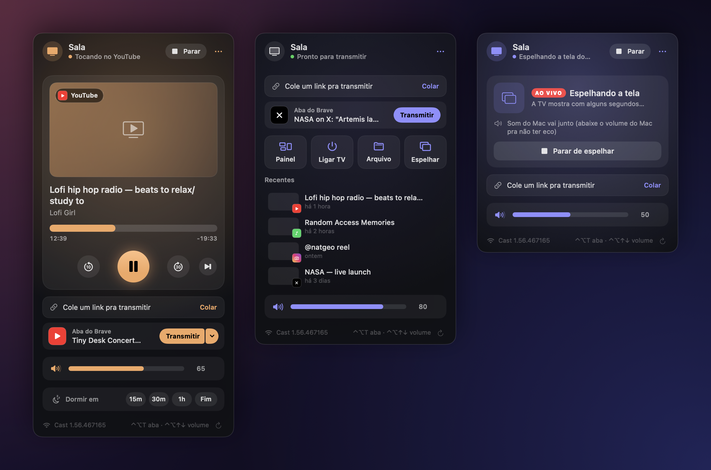
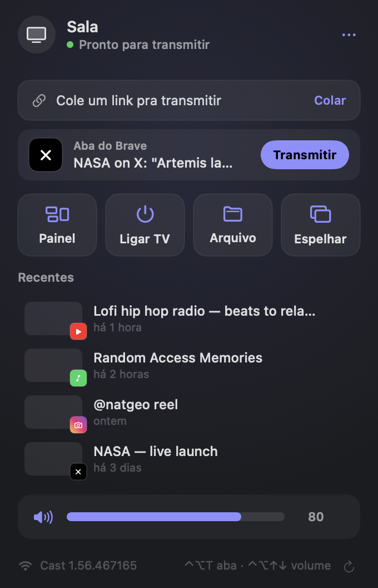
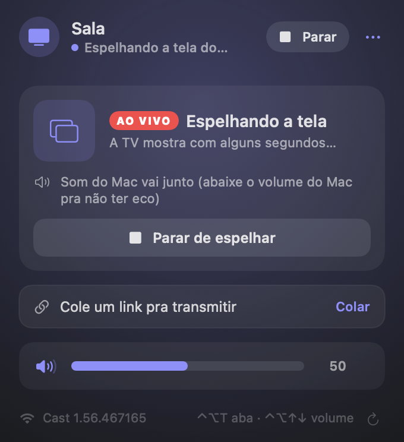

<div align="center">

# Chromecast Menubar

[English](README.md) · **Português**

**Controle o Chromecast pela barra de menus do Mac e mande YouTube, Spotify, Instagram e X pra TV direto do navegador.**

Feito para o **Chromecast de 1ª geração** (e testado nele), que continua funcionando e falando o protocolo.




</div>

## O que faz

- **Transmitir a aba do navegador:** mostra a aba ativa do Brave, Chrome, Safari, Arc ou Edge com um botão **Transmitir**, ou use **⌃⌥T** de qualquer lugar. Não depende do ícone de transmissão do navegador.
- **YouTube:** abre no app do YouTube da TV, com **tocar a seguir**, **adicionar à fila** e **próximo**. Aceita `watch`, `youtu.be`, `shorts`, `live`, playlists e `t=`.
- **Spotify:** o link toca pelo app do Spotify no Mac, que manda pra TV via Spotify Connect.
- **Instagram e X:** os vídeos são resolvidos com o [yt-dlp](https://github.com/yt-dlp/yt-dlp). O X funciona sem login; o Instagram pode usar a sessão do seu navegador (opcional).
- **Arquivos e links:** solte vídeo, música, foto ou link no painel, ou use *Abrir com → Chromecast* no Finder. HEVC e 4K são convertidos pra 1080p H.264 pra 1ª geração.
- **Espelhar o Mac:** manda a tela (e, se quiser, o som) pra TV como HLS ao vivo, com cerca de 6–8 s de atraso.
- **Tocando Agora e teclas de mídia:** ⏯ ⏮ ⏭ controlam a TV, e o widget do macOS mostra capa e progresso. **⌃⌥↑ / ⌃⌥↓** mudam o volume da TV, com aviso na tela.
- **Timer de sono:** 15m / 30m / 1h ou *fim do episódio*. No último minuto o volume abaixa aos poucos; depois a transmissão para e o volume volta ao que era.
- **Painel na TV:** relógio, data e clima em tela cheia quando nada está tocando.
- **Ligar TV:** liga a TV e troca a entrada via HDMI-CEC.
- **Menu do aparelho:** renomear ou reiniciar o Chromecast; firmware e sinal do Wi-Fi no rodapé.
- **Conexão que se recupera sozinha:** vigia de heartbeat, novas tentativas espaçadas, reconexão quando o Mac acorda ou a rede muda, e o último IP como plano B quando o Bonjour falha.
- **Português e inglês**, conforme o idioma do sistema.

| Início | Espelhando |
|:---:|:---:|
|  |  |

## Instalação

Precisa do macOS 14 ou mais novo e das Command Line Tools do Xcode (`xcode-select --install`). O Xcode completo não é necessário.

```bash
git clone https://github.com/LuisMFG/chromecast-menubar.git
cd chromecast-menubar
./build-app.sh
cp -R build/Chromecast.app /Applications/
open /Applications/Chromecast.app
```

Opcional, para Instagram, X e outros sites:

```bash
brew install yt-dlp
```

### Permissões

O macOS pede cada uma na primeira vez que ela é necessária:

| Permissão | Para quê |
|---|---|
| Rede Local | Achar e falar com o Chromecast |
| Automação (seu navegador) | Ler a aba ativa para o **Transmitir** / ⌃⌥T |
| Gravação de Tela e Áudio do Sistema | Só para espelhar |
| Acesso ao Keychain (ex.: "Brave Safe Storage") | Só se você ligar *Usar login do navegador* para Instagram/X |

**Manter as permissões entre atualizações (opcional).** Com assinatura ad-hoc, o macOS trata cada build como um app novo e pede tudo de novo. O `build-app.sh` assina com qualquer identidade cujo nome contenha `Local Code Signing`, se ela existir. Para criar uma autoassinada, veja os comandos no [README em inglês](README.md#permissions).

### Atalhos

| Onde | Tecla | Ação |
|---|---|---|
| Qualquer lugar | `⌃⌥T` | Transmitir a aba do navegador |
| Qualquer lugar | `⌃⌥↑` / `⌃⌥↓` | Volume da TV |
| Qualquer lugar | `⌃⌥Espaço`, ⏯ | Tocar / pausar |
| Qualquer lugar | ⏭ / ⏮ | +30 s / −10 s |
| Painel | `Espaço`, `←` `→`, `↑` `↓` | Tocar/pausar, avançar, volume |

## Como funciona

```
                       ┌──────────────── Cast v2 (TLS :8009, protobuf) ───────────────┐
App na barra de  ───▶  │ receiver   GET_STATUS · LAUNCH · STOP · SET_VOLUME           │
menus do Mac           │ media      PLAY · PAUSE · SEEK · LOAD                        │
                       │ setup      eureka_info · set_eureka_info · reboot            │  ◀── achado com o REA
                       │ youtube.mdx  getMdxSessionStatus → screenId                  │
                       └──────────────────────────────────────────────────────────────┘
   YouTube      screenId → Lounge API (get_lounge_token_batch → bind → setPlaylist / insertVideo / addVideo)
   Arquivos     servidor HTTP embutido (Range) → Default Media Receiver (CC1AD845)
   Instagram/X  yt-dlp → MP4/HLS direto → Default Media Receiver
   Spotify      app do Spotify no Mac (AppleScript) → Spotify Connect → receptor do Spotify (CC32E753)
   Espelhar     ScreenCaptureKit → AVAssetWriter (segmentos HLS fMP4 de 2 s) → servidor → HLS ao vivo
```

## Engenharia reversa com REA

A API de gerenciamento do aparelho foi encontrada rodando o [REA](https://github.com/morluto/rea) no app oficial **Google Home 4.31.27** para Android:

- O app não chama mais a antiga API HTTP da porta 8008. Ele tunela as mesmas rotas (`eureka_info`, `set_eureka_info`, `reboot`, `multizone/*`, `assistant/*`…) por um namespace do Cast, o **`urn:x-cast:com.google.cast.setup`**.
- O formato foi confirmado no aparelho só com leituras: `{"type": "<rota>", "request_id": n, "data": {…}}` → `{"response_code": 200, "data": …}`. No firmware 1.56 ele responde sem token de autorização.
- O `E8C28D3C` (app Backdrop) aparece no código do Google Home e bate com o que o aparelho informa quando está ocioso.

Detalhes, incluindo o que foi testado e o que não foi, em [REA-FINDINGS.md](REA-FINDINGS.md).

## Limitações

- **Serviços com DRM** (Netflix, Prime Video, Disney+, Max, Globoplay…) só transmitem pelos apps oficiais. O painel avisa isso em vez de falhar calado.
- **Spotify** só toca na TV pelos apps do próprio Spotify. No Spotify do Mac, escolha o Chromecast uma vez em *Conectar a um dispositivo*; depois ele lembra.
- **Instagram** exige sessão. Ligue *⋯ → Usar login do navegador* para o yt-dlp usar os cookies do navegador.
- **Os extratores do yt-dlp** às vezes quebram quando os sites mudam. O painel mostra o erro do yt-dlp; `brew upgrade yt-dlp` costuma resolver.
- **O espelhamento** tem alguns segundos de atraso: bom pra vídeo e apresentação, não pra jogo.
- **O timer de sono roda no Mac.** Enquanto ele está ativo o Mac não dorme por inatividade, mas se a tampa for fechada ele dispara quando o Mac acordar.

## Créditos

- [morluto/rea](https://github.com/morluto/rea), usado pra achar o canal `setup` no app Google Home.
- [FabioGNR/pyytlounge](https://github.com/FabioGNR/pyytlounge) (GPL-3.0) e [ur1katz/casttube](https://github.com/ur1katz/casttube) (MIT), referências da Lounge API do YouTube.
- [yt-dlp](https://github.com/yt-dlp/yt-dlp) e [Open-Meteo](https://open-meteo.com).

## Aviso

Projeto pessoal, sem afiliação com Google, YouTube, Spotify, Meta ou X. Use por sua conta e risco.

## Licença

[GPL-3.0](LICENSE)
